# open-file

Learn and play chess in your browser, offline

<picture>
  <source media="(prefers-color-scheme: dark)" srcset="docs/assets/smothered-mate-dark.svg">
  
</picture>

```bash
git clone https://github.com/Real-Fruit-Snacks/open-file.git && cd open-file && npm install && npm run dev
```

- **Open and play offline:** Launch [real-fruit-snacks.github.io/open-file](https://real-fruit-snacks.github.io/open-file/) with no account, no ads, and no tracking — installs as a PWA or runs locally from the standalone release offline zip.
- **Learn & tactics:** 75 interactive coached lessons across three courses, 48,000 engine-verified puzzles with Glicko-2 rating, spaced recall, opening repertoires, endgame drills, and classic games.
- **Play & analyse locally:** Stockfish 19 (multi-threaded) and optional Maia-3 human-like neural opponent run directly on your device, with game review, variation trees, and Lichess/chess.com imports.
- **Optional zero-account online play & sync:** Encrypted cross-device sync via 12-word recovery phrase, Lichess sync, live/correspondence games, and 11 chess arcade modes.

## Documentation

- [Open Live App](https://real-fruit-snacks.github.io/open-file/)
- [Usage, Screenshots, Offline Zip & Self-Hosting](docs/USAGE.md)
- [Complete Feature Reference](docs/FEATURES.md)
- [Architecture](docs/ARCHITECTURE.md) · [Deployment](docs/DEPLOYMENT.md) · [Content Guide](docs/CONTENT_GUIDE.md)
- [Contributing](CONTRIBUTING.md) · [Third-Party Notices](THIRD_PARTY_NOTICES.md)

## License

[GNU General Public License v3.0 or later](LICENSE) (with AGPL-3.0 components in [LICENSES/AGPL-3.0.txt](LICENSES/AGPL-3.0.txt) and piece-set attributions in [THIRD_PARTY_NOTICES.md](THIRD_PARTY_NOTICES.md); four piece sets are CC BY-NC-SA 4.0 and must be removed in commercial forks).
