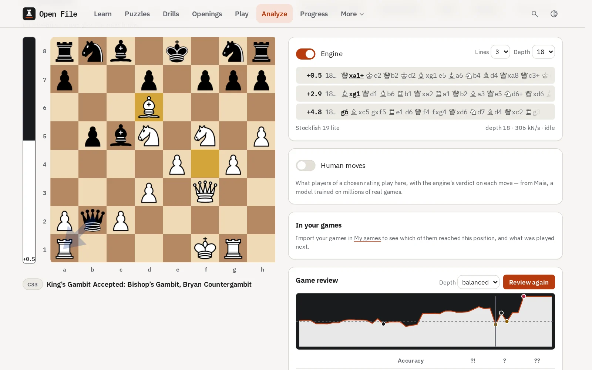
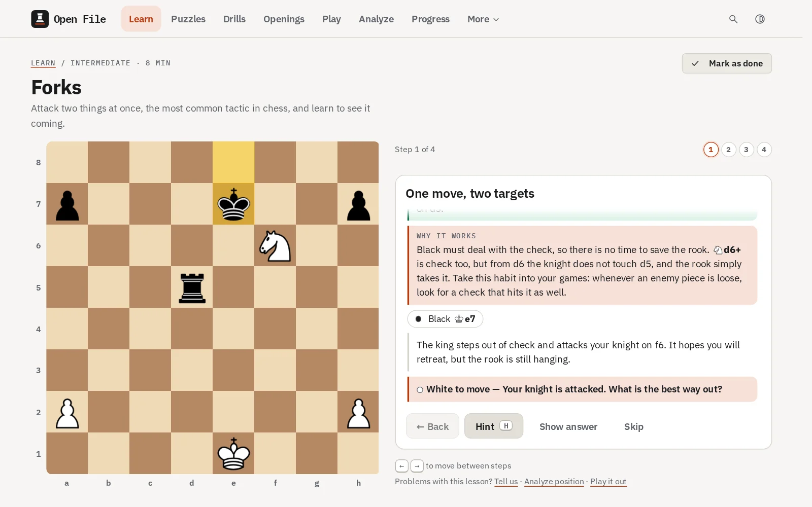
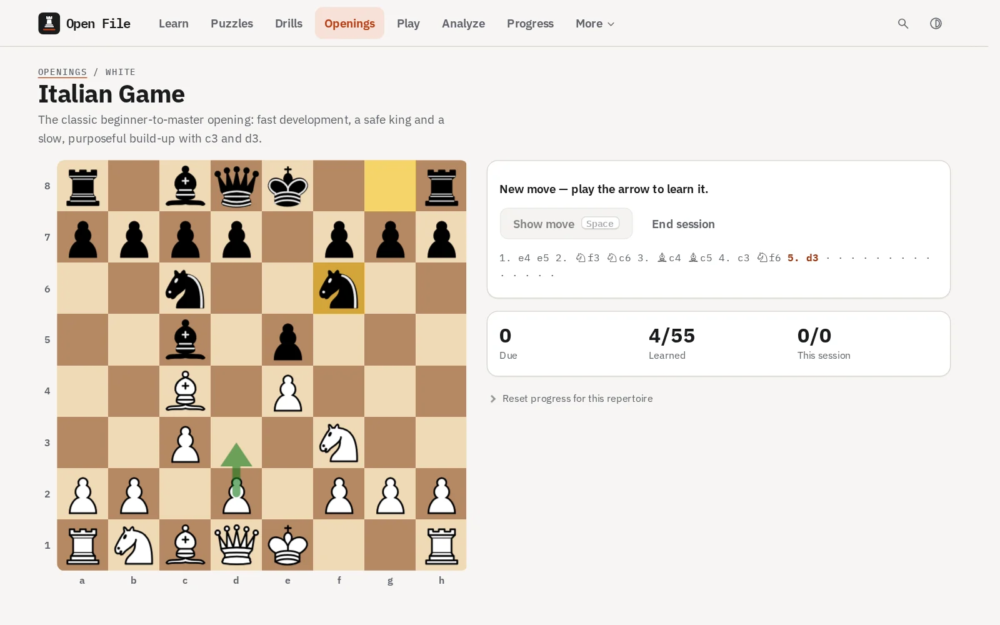
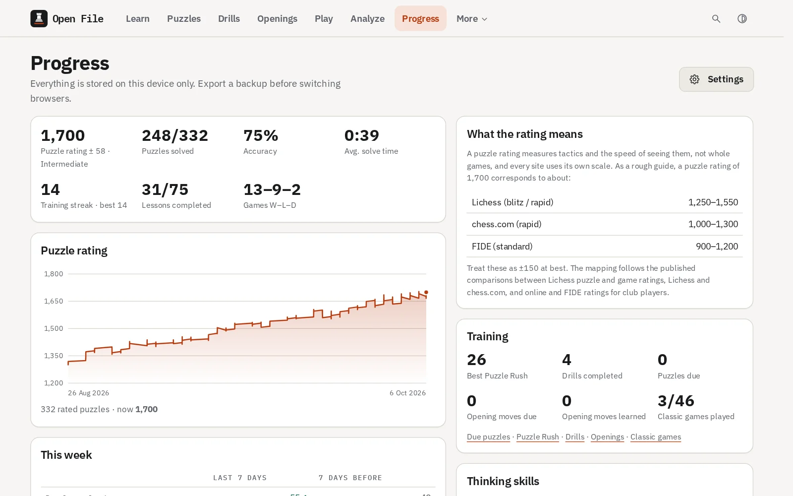
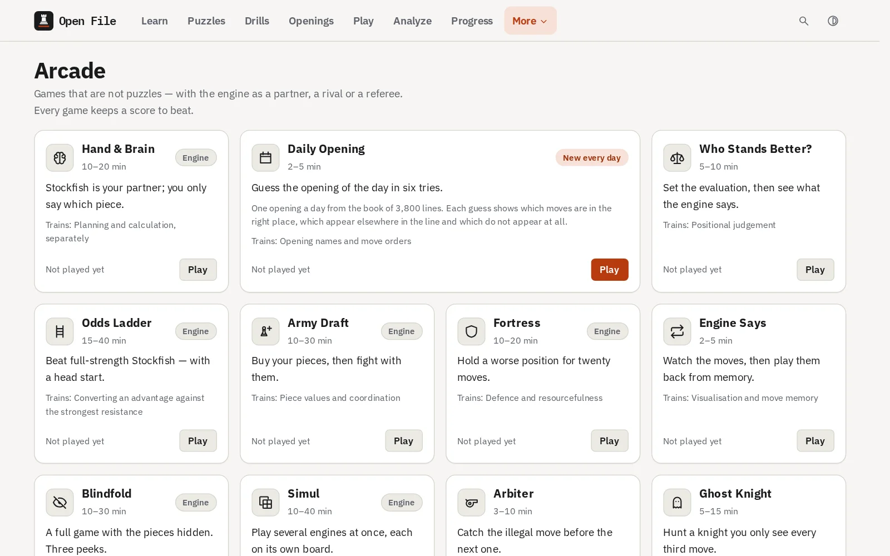
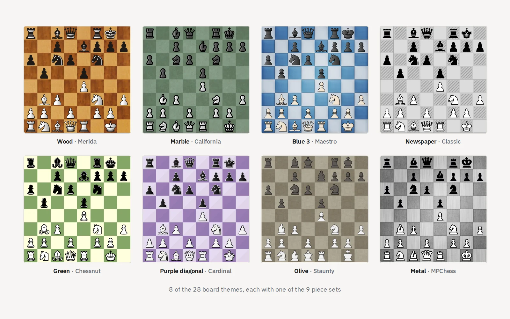

# open-file

Learn and play chess in your browser, offline

<picture>
  <source media="(prefers-color-scheme: dark)" srcset="docs/assets/smothered-mate-dark.svg">
  
</picture>

**[Open it in your browser](https://real-fruit-snacks.github.io/open-file/)** and start. There is no account to make, no ads and no tracking: your progress stays on your device, and the optional network features are off by default. Everything it needs downloads on the first visit; after that it works offline, and _Download every puzzle_ in Settings keeps all 48,000 puzzles offline too. To keep it as an app, use the install button in the address bar (Chrome and Edge), _Share → Add to Home Screen_ (iPhone and iPad) or _Menu → Install app_ (Android).

Above is the first step of _Mating patterns every player should know_, one of 75 lessons, played in the app the way a learner might: the tempting move first. Each lesson is a conversation with a coach who says why every move works, and who answers a tempting mistake by playing the reply that punishes it, on the board, until you take the move back. The pieces are Colin M.L. Burnett's ([CC BY-SA 3.0](https://creativecommons.org/licenses/by-sa/3.0/)); the sets in the other pictures are credited in [THIRD_PARTY_NOTICES.md](THIRD_PARTY_NOTICES.md#piece-sets).

To take the whole app with you, every [release](https://github.com/Real-Fruit-Snacks/open-file/releases/latest) has `open-file-<version>-offline.zip` (about 190 MB). Unzip it and double-click **Start Open File** (the `.exe` on Windows, the `.command` on macOS, `start-open-file.sh` on Linux); it opens at `http://localhost:8064/` with no internet connection.

The name: in chess, an open file is a column with no pawns on it, the road a rook takes into the game.

## What's in it

| Section         | What you get                                                                                                                                                                                                                                                                                                                                                                                   |
| --------------- | ---------------------------------------------------------------------------------------------------------------------------------------------------------------------------------------------------------------------------------------------------------------------------------------------------------------------------------------------------------------------------------------------- |
| **Learn**       | 75 interactive lessons in three courses, from how the pieces move to exchange sacrifices. A placement quiz picks your starting point, spaced recall brings back what you learned, lessons you already know are marked done in a tap, and a gallery shows the nineteen named mates.                                                                                                             |
| **Puzzles**     | 48,000 engine-verified tactics across eight rating bands, with a Glicko-2 rating, the daily puzzle, Puzzle Rush, blind puzzles (the line in notation only, the board frozen at the start), Woodpecker sets, a review queue for misses, and puzzles made from the blunders in your own games.                                                                                                   |
| **Play**        | Stockfish 19 at eight levels, from a beatable Newcomer to full strength, or Maia-3, a neural network trained on millions of real games, which plays like a person rated 600 to 2600 (an optional 25 MB download, run on your device). Clocks, take-backs, hints, a coach that pauses on a mistake, a blunder check, blindfold play, two players at one device and Chess960.                    |
| **Play online** | Live games against people with no account: post one and carry on with anything else until someone joins, join one from the list, or send a friend a private link, to a game now or to a correspondence game of days a move. Puzzle races and the two-player arcade games too. You play under a made-up name, and messages are a few set phrases, so nothing a stranger types ever reaches you. |
| **Analyze**     | Multi-line analysis by a multi-threaded Stockfish, a variation tree, game review with an evaluation graph and the key moments in words, then a second try at each of your mistakes. Beside the board, what players of a chosen rating play in the position and your own games that reached it. Lichess and chess.com imports, and a shared board for analysing with friends.                   |
| **Sync**        | Phone, tablet and computer in step, with no account: a 12-word recovery phrase, and everything encrypted on the device before it leaves. Changes made offline are merged, not overwritten. Or keep in step with your Lichess account, both ways.                                                                                                                                               |
| **Train**       | Coordinate, vision and endgame drills on a 41-rung ladder, "What's the threat?", sixteen opening repertoires trained with spaced repetition (or your own), eight endgame studies and 46 classic games to guess move by move.                                                                                                                                                                   |
| **Arcade**      | Eleven games that are not puzzles: a simul against up to eight engines, Hand & Brain with Stockfish as your partner, a daily opening Wordle, Who Stands Better?, the Odds Ladder, Army Draft, Fortress, Engine Says, Blindfold, Arbiter and Ghost Knight.                                                                                                                                      |

<table>
  <tr>
    <td width="33%"></td>
    <td width="33%"></td>
    <td width="33%"></td>
  </tr>
  <tr>
    <td align="center">Game review</td>
    <td align="center">Lessons with a coach</td>
    <td align="center">Opening repertoires</td>
  </tr>
  <tr>
    <td width="33%"></td>
    <td width="33%"></td>
    <td width="33%"></td>
  </tr>
  <tr>
    <td align="center">Progress</td>
    <td align="center">The arcade</td>
    <td align="center">Board themes and piece sets</td>
  </tr>
</table>

Every section in detail: [docs/FEATURES.md](docs/FEATURES.md). How it is built: [docs/ARCHITECTURE.md](docs/ARCHITECTURE.md). Contributing, especially chess content: [CONTRIBUTING.md](CONTRIBUTING.md) and the [content guide](docs/CONTENT_GUIDE.md).

## Tested on

- Any evergreen browser with WebAssembly and Web Workers: Chrome and Edge 111+, Firefox 121+, Safari 16.4+ (iOS 16.4+)
- CI on every push: lint, typecheck, unit tests with a coverage floor, the puzzle data, the end-to-end suite on desktop and phone Chromium, Firefox and WebKit, visual snapshots and Lighthouse; a separate workflow checks every lesson, drill, study and repertoire move with Stockfish ([what CI runs](CONTRIBUTING.md#what-ci-runs))
- _Not_ tested: browsers older than those above, which lack the features the engine needs

## Known issues

- Browsers give a site about 5 MB of local storage. The app caps what it keeps (recent puzzles, games, analyses) to stay inside it, and keeps running if a write no longer fits; a backup or device sync keeps the rest.
- The human-like opponent (about 25 MB) and Stockfish's full network (about 99 MB) are optional downloads, kept on the device once fetched.
- Device sync, live games and notifications while the app is closed need the relay. The public build uses mine; a fork either deploys its own or turns them off (see [Run your own copy](#run-your-own-copy)).
- The interface is in British English only.
- Four piece sets (California, Maestro, Staunty, Cardinal) are CC BY-NC-SA 4.0: a commercial fork must remove them.

## Run your own copy

Everything the app can be set to is under Settings, listed in [docs/FEATURES.md](docs/FEATURES.md). To run or host your own copy:

```bash
git clone https://github.com/Real-Fruit-Snacks/open-file.git
cd open-file
npm install     # Node 22.22 or newer
npm run dev     # downloads the engine and the human-like opponent on first run, then serves http://localhost:5173
npm run check   # CI's quality and build gates: lint, dead code, format, typecheck, unit tests, build, bundle budget
```

To host a fork, enable its workflows on the **Actions** tab, set **Settings → Pages → Source** to **GitHub Actions**, and push to `main`; once CI passes, the deploy workflow publishes it, and a version tag publishes a release with the offline copy. Custom domains and other static hosts: [docs/DEPLOYMENT.md](docs/DEPLOYMENT.md).

`src/site.config.ts` holds the name, URLs and the sync relay. Device sync, live games and pushed notifications go through a small relay of your own, a Cloudflare Worker (free plan) or a plain Node server: [relay/README.md](relay/README.md) shows how to deploy it and what it can and cannot see. Setting `syncRelay` to `''` leaves all three out.

## License

Open File is licensed under the [GNU General Public License v3.0 or later](LICENSE). It bundles
GPL-licensed components that are inseparable from the delivered app (Chessground for the board,
Stockfish for the engine), so a copyleft licence for the whole is the honest choice. The human-like
opponent's model, Maia-3, and Lichess's board pictures are under the GNU Affero General Public
License v3, which the GPL v3 allows the app to be combined with
([LICENSES/AGPL-3.0.txt](LICENSES/AGPL-3.0.txt)). Third-party components
and their licences are listed in [THIRD_PARTY_NOTICES.md](THIRD_PARTY_NOTICES.md). The built site
ships the texts (`licence.txt`, `licence-agpl.txt`, `licence-apache.txt`, `licence-ofl.txt` for the IBM
Plex fonts, and `notices.txt`) and links
them from the footer of every page, next to the credits the components ask for — among them the
chosen piece set's. The piece sets come from the Lichess collection under their own licences; four of
them (California, Maestro, Staunty and Cardinal) are CC BY-NC-SA 4.0 and may not be used commercially,
so a commercial fork must remove them (see THIRD_PARTY_NOTICES.md).
