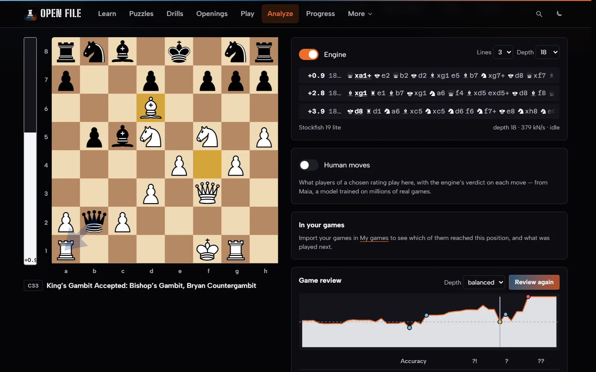
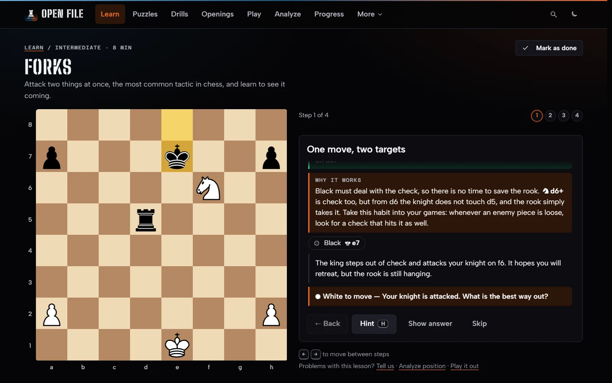
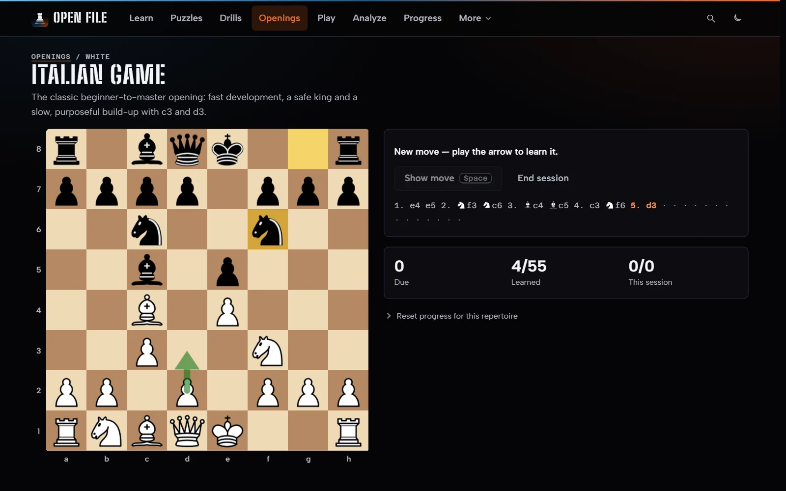
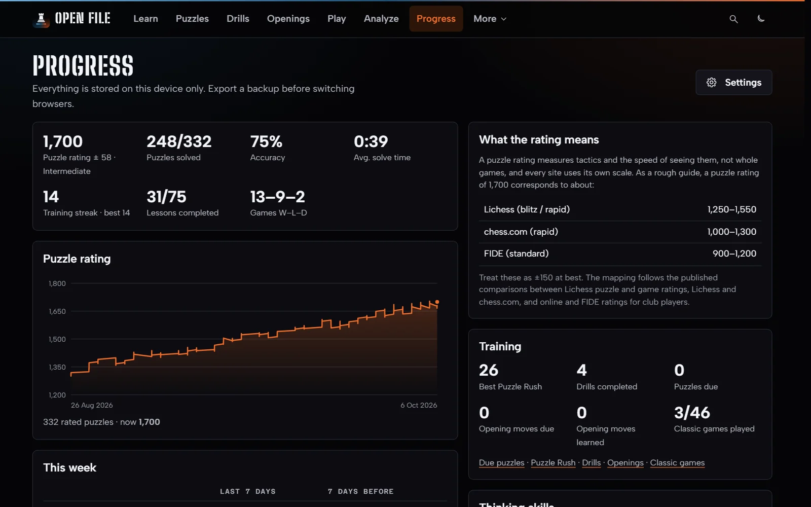
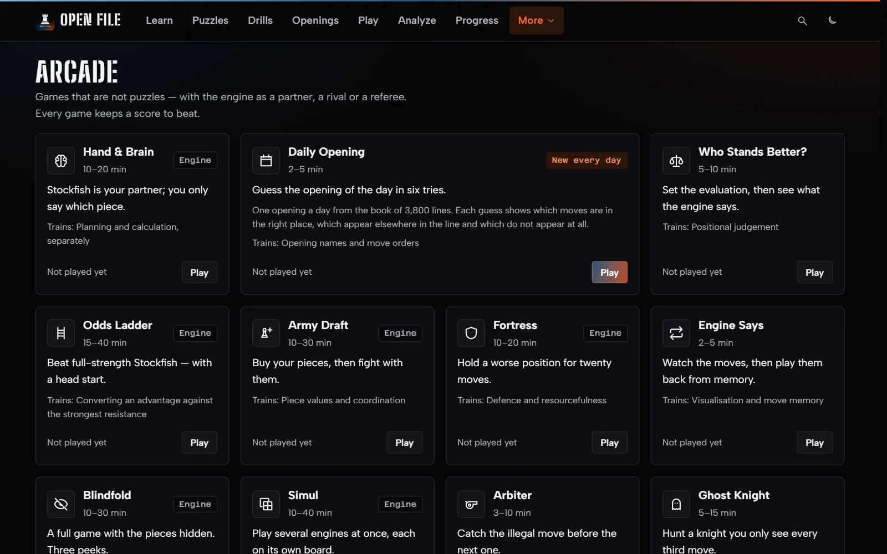
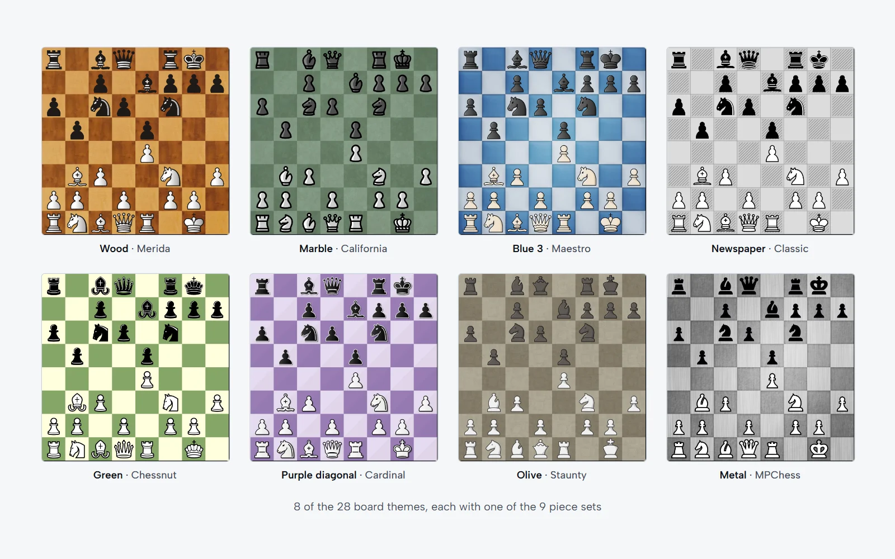

# Open File Usage, Offline Copy & Hosting

Overview of every section, screenshots, offline distribution, browser support, known issues, and self-hosting instructions for Open File. For deep reference see [FEATURES.md](FEATURES.md), [ARCHITECTURE.md](ARCHITECTURE.md), [DEPLOYMENT.md](DEPLOYMENT.md), and [CONTENT_GUIDE.md](CONTENT_GUIDE.md).

## What's In It

| Section         | What you get                                                                                                                                                                                                                                                                                                                                                                                   |
| --------------- | ---------------------------------------------------------------------------------------------------------------------------------------------------------------------------------------------------------------------------------------------------------------------------------------------------------------------------------------------------------------------------------------------- |
| **Learn**       | 75 interactive lessons in three courses, from how the pieces move to exchange sacrifices. A placement quiz picks your starting point, spaced recall brings back what you learned, lessons you already know are marked done in a tap, and a gallery shows the nineteen named mates.                                                                                                             |
| **Puzzles**     | 48,000 engine-verified tactics across eight rating bands, with a Glicko-2 rating, the daily puzzle, Puzzle Rush, blind puzzles (the line in notation only, the board frozen at the start), Woodpecker sets, a review queue for misses, and puzzles made from the blunders in your own games.                                                                                                   |
| **Play**        | Stockfish 19 at eight levels, from a beatable Newcomer to full strength, or Maia-3, a neural network trained on millions of real games, which plays like a person rated 600 to 2600 (an optional 25 MB download, run on your device). Clocks, take-backs, hints, a coach that pauses on a mistake, a blunder check, blindfold play, two players at one device and Chess960.                    |
| **Play online** | Live games against people with no account: post one and carry on with anything else until someone joins, join one from the list, or send a friend a private link, to a game now or to a correspondence game of days a move. Puzzle races and the two-player arcade games too. You play under a made-up name, and messages are a few set phrases, so nothing a stranger types ever reaches you. |
| **Analyze**     | Multi-line analysis by a multi-threaded Stockfish, a variation tree, game review with an evaluation graph and the key moments in words, then a second try at each of your mistakes. Beside the board, what players of a chosen rating play in the position and your own games that reached it. Lichess and chess.com imports, and a shared board for analysing with friends.                   |
| **Sync**        | Phone, tablet and computer in step, with no account: a 12-word recovery phrase, and everything encrypted on the device before it leaves. Changes made offline are merged, not overwritten. Or keep in step with your Lichess account, both ways.                                                                                                                                               |
| **Train**       | Coordinate, vision and endgame drills on a 41-rung ladder, "What's the threat?", sixteen opening repertoires trained with spaced repetition (or your own), eight endgame studies and 46 classic games to guess move by move.                                                                                                                                                                   |
| **Arcade**      | Eleven games that are not puzzles: a simul against up to eight engines, Hand & Brain with Stockfish as your partner, a daily opening Wordle, Who Stands Better?, the Odds Ladder, Army Draft, Fortress, Engine Says, Blindfold, Arbiter and Ghost Knight.                                                                                                                                      |

## Screenshots

<table>
  <tr>
    <td width="33%"></td>
    <td width="33%"></td>
    <td width="33%"></td>
  </tr>
  <tr>
    <td align="center">Game review</td>
    <td align="center">Lessons with a coach</td>
    <td align="center">Opening repertoires</td>
  </tr>
  <tr>
    <td width="33%"></td>
    <td width="33%"></td>
    <td width="33%"></td>
  </tr>
  <tr>
    <td align="center">Progress</td>
    <td align="center">The arcade</td>
    <td align="center">Board themes and piece sets</td>
  </tr>
</table>

## Offline Copy & PWA Install

- **Install as an app:** Open [real-fruit-snacks.github.io/open-file](https://real-fruit-snacks.github.io/open-file/), use your browser's install button (Chrome/Edge), _Share -> Add to Home Screen_ (iOS/iPadOS), or _Menu -> Install app_ (Android). Use _Download every puzzle_ in Settings to cache all 48,000 puzzles offline.
- **Standalone offline zip:** Every [release](https://github.com/Real-Fruit-Snacks/open-file/releases/latest) includes `open-file-<version>-offline.zip` (about 190 MB). Unzip it and double-click **Start Open File** (`.exe` on Windows, `.command` on macOS, `start-open-file.sh` on Linux) to run at `http://localhost:8064/` with no internet connection.
- **Offline Windows dev kit:** Each release also includes `open-file-<version>-dev-windows-x64.zip` (about 420 MB) with packages, engine, model, and browser for offline development ([Developing offline](../CONTRIBUTING.md#developing-offline)).

## Tested On

- Any evergreen browser with WebAssembly and Web Workers: Chrome and Edge 111+, Firefox 121+, Safari 16.4+ (iOS 16.4+).
- CI on every push: lint, typecheck, unit tests with a coverage floor, puzzle data checks, Playwright E2E across desktop and mobile Chromium, Firefox, and WebKit, visual snapshots, Lighthouse, and a separate Stockfish content verification workflow ([what CI runs](../CONTRIBUTING.md#what-ci-runs)).
- _Not_ tested: browsers older than those above, which lack required WebAssembly/Worker features.

## Known Issues

- Browsers give a site about 5 MB of local storage. The app caps recent puzzles, games, and analyses to stay within it, and keeps running if a write no longer fits; a backup or device sync keeps the rest.
- The human-like opponent (Maia-3, ~25 MB) and Stockfish's full network (~99 MB) are optional downloads, cached locally once fetched.
- Device sync, live games, and notifications while the app is closed need the relay. The public build uses the hosted relay; forks can deploy their own or disable it (`syncRelay: ''`).
- The interface is in British English only.
- Four piece sets (California, Maestro, Staunty, Cardinal) are CC BY-NC-SA 4.0: a commercial fork must remove them.

## Run Your Own Copy

Everything the app can be set to is under Settings (listed in [FEATURES.md](FEATURES.md)). To run or host your own copy:

```bash
git clone https://github.com/Real-Fruit-Snacks/open-file.git
cd open-file
npm install     # Node 22.22 or newer
npm run dev     # downloads the engine and the human-like opponent on first run, then serves http://localhost:5173
npm run check   # CI's quality and build gates: lint, dead code, format, typecheck, unit tests, build, bundle budget
```

To host a fork, enable workflows on the **Actions** tab, set **Settings -> Pages -> Source** to **GitHub Actions**, and push to `main`. Custom domains and other static hosts are documented in [DEPLOYMENT.md](DEPLOYMENT.md).

`src/site.config.ts` holds the site name, URLs, and sync relay. Device sync, live games, and push notifications go through a small relay (Cloudflare Worker or Node server — see [relay/README.md](../relay/README.md)); setting `syncRelay` to `''` disables all three.

## Piece Set & Font Credits

The pieces in the README cover are Colin M.L. Burnett's ([CC BY-SA 3.0](https://creativecommons.org/licenses/by-sa/3.0/)). Third-party components, bundled fonts (`Big Shoulders Stencil`, `Albert Sans`, `Azeret Mono` under SIL OFL 1.1), and piece set licences are credited in [THIRD_PARTY_NOTICES.md](../THIRD_PARTY_NOTICES.md).
